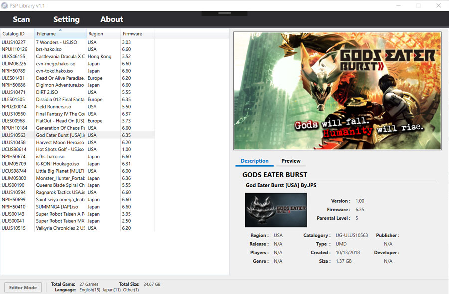
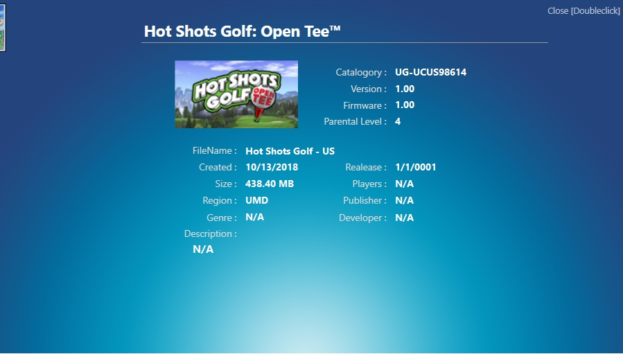
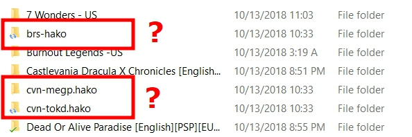

# PSP Library

**ดูให้รู้ว่า ISO แต่ละไฟล์คือเกมอะไร ก่อนจะเปิดเล่น**

โปรแกรม Windows เล็ก ๆ ที่อ่านโฟลเดอร์เกม PSP แล้วแสดงปก ชื่อเกม รหัสแผ่น ภูมิภาค และเฟิร์มแวร์ของแต่ละเกม ไม่ต้องเดาจากชื่อไฟล์แปลก ๆ อย่าง `cvn-tokd.hako` อีกต่อไป

[เว็บไซต์](http://dvgamerr.app/psp-library-win/) · [เริ่มใช้งาน](#เริ่มใช้งาน) · [Changelog](docs/changelog.md) · [English](README.md)

**ถ้าโปรแกรมนี้ช่วยให้คุณไม่ต้องเปิดโฟลเดอร์ ISO ปริศนาทีละไฟล์ ฝากกด ⭐ ให้ด้วยนะ จะช่วยให้คนเล่น PSP คนอื่นหาเจอ**

## ทำไมต้องใช้

- **รู้จักทุก ISO ในพริบตา** ชื่อเกม ปก รหัสแผ่น เวอร์ชัน เฟิร์มแวร์ ระดับผู้ปกครอง และภูมิภาค อ่านจาก `PARAM.SFO`, `ICON0.PNG` และ `PIC1.PNG` ในตัวเกมเอง
- **ไม่แตะไฟล์ ISO ของคุณ** เปิดแบบอ่านอย่างเดียว ข้อมูลที่ดึงมาเก็บไว้ในโฟลเดอร์ `PSPStore` ข้างโปรแกรม
- **ไม่ต้องติดตั้ง** โหลด zip แตกไฟล์ แล้วเปิด `PSPlibrary.exe`
- **สรุปทั้งคอลเลกชัน** จำนวนเกม ขนาดรวม และสัดส่วน English / Japan / Other ที่แถบสถานะ

## ความสามารถ

| | ความสามารถ | ทำอะไร |
|---|---|---|
| 📚 | **รายการเกม** | รหัสแผ่น ชื่อไฟล์ ภูมิภาค และเฟิร์มแวร์ของทุก ISO ในโฟลเดอร์ เรียงลำดับได้ |
| 🖼️ | **ปกและพื้นหลัง** | แสดงไอคอนและภาพพื้นหลัง `PIC1` ที่ดึงจากใน ISO |
| 🔎 | **รายละเอียดเกม** | ชื่อ เวอร์ชัน เฟิร์มแวร์ ระดับผู้ปกครอง ประเภทแผ่น (UMD / CD-DVD / Blu-ray) ขนาด และวันที่สร้าง |
| 🪟 | **ดูเกมเดียวแบบเร็ว** | เปิด `.iso` ด้วย PSP Library เพื่อดูรายละเอียดโดยไม่ต้องสแกนทั้งโฟลเดอร์ |
| 📊 | **สรุปคอลเลกชัน** | จำนวนเกม ขนาดรวม และจำนวนตามภูมิภาค |
| 💾 | **จำค่าที่ตั้งไว้** | บันทึกตำแหน่ง ขนาดหน้าต่าง และความกว้างคอลัมน์ไว้ใช้ครั้งหน้า |

## เริ่มใช้งาน

1. โหลด `psp-library-v1.1-release-x64.zip` (หรือ `x86`) จาก [release ล่าสุด](https://github.com/dvgamerr-app/psp-library-win/releases/latest)
2. แตกไฟล์ที่ไหนก็ได้ แล้วเปิด `PSPlibrary.exe` ต้องใช้ Windows ที่มี .NET Framework 4.0 ขึ้นไป
3. เปิดครั้งแรกให้เลือกโฟลเดอร์ที่เก็บเกม PSP
4. รอสแกนเสร็จ แล้วเลือกเกมในรายการเพื่อดูรายละเอียด

ถ้าอยากดูเกมเดียว รัน `PSPlibrary.exe "C:\path\to\game.iso"` หรือคลิกขวา **Open with** ที่ไฟล์ `.iso`

> [!WARNING]
> **การสแกนจะจัดโฟลเดอร์เกมใหม่** ไฟล์ `.iso`, `.cso` หรือ `.pbp` ที่อยู่ตรงในโฟลเดอร์ที่เลือกจะถูกย้ายเข้าโฟลเดอร์ย่อยที่ตั้งชื่อตามไฟล์ ควรชี้ไปที่โฟลเดอร์ที่ยอมให้จัดใหม่ได้ หรือสำรองไว้ก่อน เรื่องนี้ติดตามอยู่ใน [docs/issue.md](docs/issue.md)

## ข้อจำกัดตอนนี้

- อ่านรายละเอียดจากไฟล์ `.iso` เท่านั้น ยังไม่รองรับ `.cso` และ `.pbp`
- Editor Mode (แก้คำอธิบาย แนวเกม ฯลฯ) ยังไม่เปิดใช้ในเวอร์ชันนี้
- ใช้ได้บน Windows เท่านั้น

## ภาพหน้าจอเพิ่มเติม

ดูเพิ่ม

## Build จาก source

1. เปิด `PSPlibrary.sln` ด้วย Visual Studio
2. Restore NuGet (`DiscUtils` 0.11.0.2)
3. Build แบบ **Release** สำหรับ **x64** หรือ **x86**

Stack: C#, WPF, .NET Framework 4.0 และ [DiscUtils](https://github.com/DiscUtils/DiscUtils) สำหรับอ่าน ISO 9660

## เอกสาร

- [Changelog](docs/changelog.md)
- [ปัญหาที่พบจากการรีวิวโค้ด](docs/issue.md)

## สนับสนุนโปรเจกต์

- ⭐ [กด Star ให้ repo](https://github.com/dvgamerr-app/psp-library-win)
- 🐛 [แจ้งบั๊กหรือขอฟีเจอร์](https://github.com/dvgamerr-app/psp-library-win/issues)

PSP Library เป็นเครื่องมือของแฟนเกม ไม่มีส่วนเกี่ยวข้องกับ Sony Interactive Entertainment และไม่ได้รวมหรือดาวน์โหลดเกมใด ๆ
